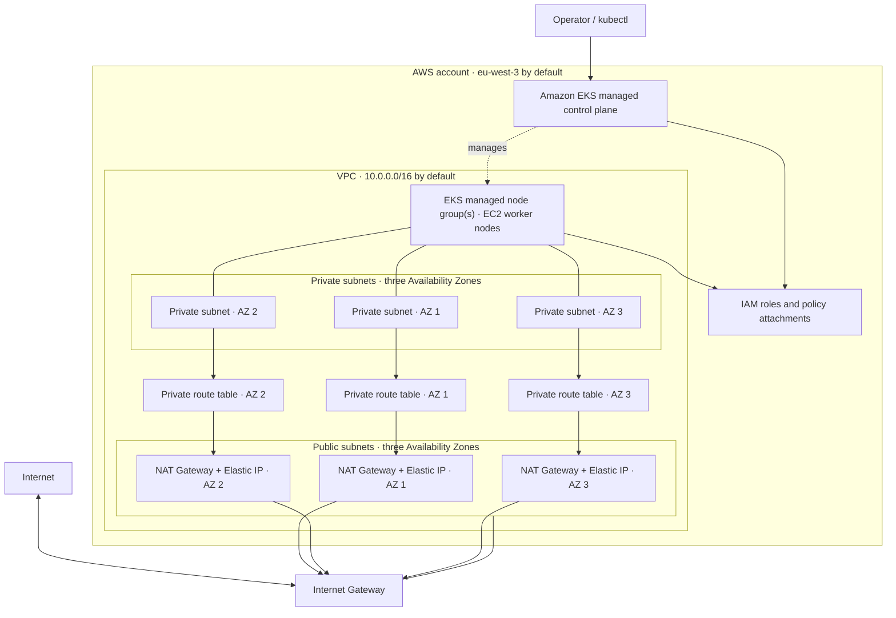

# AWS EKS Infrastructure

This folder contains the Terraform configuration for provisioning the networking and compute foundation of the **e-commerce-ops** demo on AWS. It highlights practical infrastructure-as-code skills: reusable modules, private networking, managed Kubernetes, IAM roles, and configurable node-group scaling.

## What it provisions

- **Amazon VPC** with configurable CIDR ranges and subnets across three Availability Zones by default.
- **Public subnets** with an Internet Gateway route and public IP assignment on launch.
- **Private subnets** for EKS worker nodes. Each private subnet routes outbound traffic through a NAT Gateway in its corresponding public subnet.
- **Amazon EKS cluster** configured with a selectable Kubernetes version.
- **Managed EKS node group(s)** deployed into the private subnets, with configurable instance types, capacity type, and minimum, desired, and maximum size.
- **IAM roles and managed policy attachments** for the EKS control plane and worker nodes.

## Architecture



The EKS control plane is managed by AWS. Worker nodes are placed in private subnets rather than exposed directly to the internet. NAT Gateways provide outbound connectivity from those subnets; the Internet Gateway provides a route for public subnet resources.

## Technology

| Technology | Purpose |
| --- | --- |
| Terraform | Declarative provisioning and lifecycle management |
| AWS provider for Terraform (`hashicorp/aws` 5.x) | Creates and configures AWS resources |
| Amazon VPC | Isolated network, subnets, routing, and internet egress |
| Amazon EKS | Managed Kubernetes control plane |
| EC2 managed node groups | Kubernetes worker compute and scaling |
| AWS IAM | Service roles and permissions for cluster and worker nodes |

## Repository layout

```text
infra/
├── main.tf                 # AWS provider and composition of VPC and EKS modules
├── variables.tf            # Root defaults and configurable cluster/network settings
├── outputs.tf              # Cluster endpoint, cluster name, and VPC ID
└── modules/
    ├── VPC/                # VPC, subnets, gateways, route tables, and outputs
    └── EKS/                # Cluster, node group, IAM roles, and outputs
```

## Deploy

### Prerequisites

- Terraform installed.
- AWS CLI installed and authenticated with credentials authorized to create the required VPC, IAM, EKS, and EC2 resources.
- An AWS region and Kubernetes version that support the selected EKS configuration and instance types.

### Commands

Run these commands from this `infra` directory:

```bash
terraform init
terraform validate
terraform plan
terraform apply
```

Review the plan before applying. Terraform prints the cluster outputs when provisioning completes.

### Connect to the cluster

After the cluster is ready, add its credentials to your local kubeconfig:

```bash
aws eks update-kubeconfig --region eu-west-3 --name my-eks-cluster
```

This command uses your active AWS CLI credentials and context. If you changed the configured region or cluster name, replace the values accordingly. You can then use `kubectl` to interact with the cluster.

To remove the demo infrastructure when finished:

```bash
terraform destroy
```

## Configuration

The defaults are defined in [`variables.tf`](./variables.tf). You can override values using a `.tfvars` file or `-var` arguments. Common settings include:

- `cluster_name` and `cluster_version`
- `vpc_cidr`, `availability_zones`, and public/private subnet CIDRs
- `node_groups`, including instance type, capacity type, and scaling bounds

For example, supply a separate variables file without changing the defaults:

```bash
terraform plan -var-file="training.tfvars"
terraform apply -var-file="training.tfvars"
```

The AWS provider region is currently set directly in [`main.tf`](./main.tf) to `eu-west-3`; change it there to deploy in a different region.

## Work in progress and future improvements

This infrastructure is still a work in progress and is intended as a single-user demo. Terraform state currently uses the local backend, which is sufficient for this learning project because collaboration is not required. A planned improvement is to configure a remote backend, such as an S3 bucket, with a DynamoDB table for state locking to support safe team collaboration.

## Cost and operational notes

This is a learning/demo configuration, not a production-ready platform. AWS charges may apply for the EKS control plane, EC2 instances, NAT Gateways, Elastic IPs, and data transfer. NAT Gateways in particular can incur ongoing hourly and data-processing charges. Check current pricing for your region, use `terraform destroy` when the environment is no longer needed, and verify in the AWS Console that resources have been removed.

Before using this as a production foundation, add and review requirements such as remote and locked Terraform state, least-privilege IAM, cluster endpoint access controls, encryption and logging settings, monitoring, and workload-specific security policies.